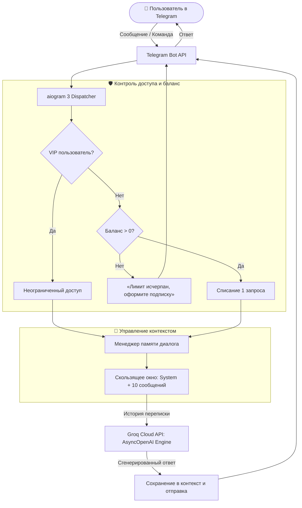

<div align="center">

# 🤖 Groq AI Assistant Telegram Bot

**Асинхронный Telegram-бот ассистент с памятью диалога, системой тарифов (Free/VIP квоты) и сверхбыстрым LLM-инференсом на базе Groq Cloud API.**

[](https://www.python.org/)
[](https://github.com/aiogram/aiogram)
[](https://groq.com/)
[](https://github.com/393748)
[](https://www.docker.com/)
[](LICENSE)

[Возможности](#-ключевые-возможности) •
[Статус разработки](#-статус-проекта-и-roadmap) •
[Архитектура](#-архитектура-и-логика) •
[Примеры работы](#-примеры-работы) •
[Стек технологий](#-стек-технологий) •
[Быстрый старт](#-быстрый-старт) •
[Docker](#-запуск-через-docker) •
[Структура](#-структура-проекта)

</div>

---

> [!IMPORTANT]
> ### 🚧 Проект находится в активной разработке (Work in Progress)
> Бот активно развивается: сейчас реализовано ядро общения, скользящее контекстное окно и квотирование запросов. В процессе внедрения — платёжная система через **Telegram Stars**, персистентное хранилище (PostgreSQL/Redis) и динамическое переключение моделей.

---

## 🌟 Ключевые возможности

- ⚡ **Сверхбыстрый инференс на Groq Cloud LPU:**
  - Обращение к LLM-моделям через OpenAI-совместимый асинхронный клиент (`AsyncOpenAI`) со скоростью отклика в сотни токенов в секунду.
  - Высокая пропускная способность и минимальная задержка генерации ответа.
- 🧠 **Скользящее контекстное окно памяти:**
  - Бот запоминает историю беседы (до 10 последних сообщений + неизменяемый системный промпт), что обеспечивает связность диалога.
  - Автоматическая ротация истории исключает превышение контекстных лимитов токенов.
  - Быстрая очистка контекста в любой момент по команде `/reset` или по кнопке `♺Сброс`.
- 💳 **Система квот и разделение прав (Free Tier vs VIP):**
  - **Бесплатный тариф:** базовый лимит запросов (по умолчанию 3 запроса) для ознакомления с возможностями ассистента.
  - **VIP-пользователи:** неограниченный доступ и увеличенный лимит контекста без списания баланса.
  - Команда `/balance` для проверки текущего доступного количества обращений.
- 🎛 **Интуитивная клавиатура меню:**
  - Быстрый доступ к базовым функциям: `👋 Поздороваться`, `ℹ️ Помощь`, `🤖Разработчик`, `♺Сброс`.

---

## 🗺 Статус проекта и Roadmap

| Функция | Статус | Описание |
|:---|:---:|:---|
| **Асинхронный каркас (aiogram 3.x)** | ✅ Готово | Неблокирующая архитектура с поддержкой polling/webhook |
| **Интеграция с Groq Cloud API** | ✅ Готово | Подключение через `AsyncOpenAI` с кастомным base_url |
| **Скользящее контекстное окно** | ✅ Готово | Поддержание истории диалога на 10 сообщений |
| **Система квот и VIP-доступ** | ✅ Готово | Контроль баланса запросов и проверка статуса |
| **Кнопочный интерфейс и команды** | ✅ Готово | `/start`, `/help`, `/reset`, `/balance` |
| **Оплата через Telegram Stars (`/buy`)** | 🔄 В разработке | Покупка дополнительных пакетов запросов напрямую в Telegram |
| **Персистентная база данных** | 🔄 В разработке | Переход с in-memory словарей на Redis / PostgreSQL |
| **Streaming-ответы (печатание на лету)** | 📋 Запланировано | Потоковая отправка токенов через Telegram Edit Message |
| **Выбор моделей (`/model`)** | 📋 Запланировано | Переключение между Llama 3.3 70B, Mixtral 8x7B и др. |

---

## 🏛 Архитектура и логика



---

## 💬 Примеры работы

### 1. Поддержание диалога в контексте
> **Пользователь:** *Расскажи в двух словах, что такое асинхронность в Python.*  
> **Бот:** *Асинхронность позволяет выполнять другие задачи, пока программа ожидает ответа (например, сетевого запроса или ввода-вывода), не блокируя основной поток.*  
> **Пользователь:** *А какая библиотека для этого используется?*  
> **Бот:** *Основная встроенная библиотека — `asyncio`, а для Telegram-ботов стандартом является `aiogram`.*

### 2. Контроль баланса
> **Пользователь:** `/balance`  
> **Бот:** `💰 Ваш текущий баланс: 2 запросов к ИИ ассистенту`

---

## 🛠 Стек технологий

| Инструмент | Роль в проекте |
|:---|:---|
| **Python 3.10+** | Язык программирования |
| **[aiogram 3](https://github.com/aiogram/aiogram)** | Современный асинхронный фреймворк для Telegram ботов |
| **[OpenAI Python SDK](https://github.com/openai/openai-python)** | Асинхронный клиент для взаимодействия с API |
| **[Groq Cloud](https://groq.com/)** | Платформа ультрабыстрого инференса больших языковых моделей |
| **python-dotenv** | Изоляция секретных переменных окружения |
| **Docker & Docker Compose** | Контейнеризация и воспроизводимое окружение |
| **GitHub Actions** | Автоматизированная проверка качества кода (CI) |

---

## 🚀 Быстрый старт

### 1. Клонирование репозитория
```bash
git clone git@github.com:393748/ai-assistant-bot.git
cd ai-assistant-bot
```

### 2. Настройка виртуального окружения
```bash
python3 -m venv .venv
source .venv/bin/activate  # На Windows: .venv\Scripts\activate
pip install --upgrade pip
pip install -r requirements.txt
```

### 3. Настройка переменных окружения
Создайте файл `.env`:
```bash
cp .env.example .env
```

Заполните переменные:
```env
BOT_TOKEN=123456789:ABCdefGHIjklMNOpqrsTUVwxyz
GROQ_API_KEY=gsk_your_groq_api_key_here
```

| Переменная | Описание | Где получить |
|:---|:---|:---|
| `BOT_TOKEN` | Токен Telegram-бота | [@BotFather](https://t.me/BotFather) |
| `GROQ_API_KEY` | Ключ доступа к сверхбыстрому LLM API | [Groq Console](https://console.groq.com/keys) |

### 4. Запуск бота
```bash
python3 bot.py
```

---

## 🐳 Запуск через Docker

```bash
# 1. Заполните переменные в .env
cp .env.example .env

# 2. Сборка и запуск в фоновом режиме
docker compose up -d --build

# 3. Просмотр логов
docker compose logs -f
```

---

## 📁 Структура проекта

```text
ai-assistant-bot/
├── .github/
│   └── workflows/
│       └── ci.yml             # GitHub Actions: CI синтаксиса и стиля
├── bot.py                     # Основная логика: aiogram handlers, Groq LLM, квоты
├── requirements.txt           # Зависимости Python (aiogram, openai, dotenv)
├── Dockerfile                 # Легковесный образ Python для деплоя
├── docker-compose.yml         # Манифест для быстрого запуска контейнера
├── .dockerignore              # Исключения при сборке образа
├── .editorconfig              # Стандарты форматирования отступов
├── .env.example               # Шаблон ключей API
├── .gitignore                 # Защита от утечки секретов и кэша
├── LICENSE                    # Лицензия MIT
└── README.md                  # Документация проекта для портфолио
```

---

## 🔒 Безопасность

Файлы `.env` и секретные токены защищены правилами `.gitignore` и никогда не попадут в систему контроля версий.

---

## 👤 Автор

- **GitHub:** [@393748](https://github.com/393748)
- **Telegram:** [@sgajdisk](https://t.me/sgajdisk)

---

## 📄 Лицензия

Проект распространяется под лицензией **MIT**. Подробности в файле [LICENSE](LICENSE).
